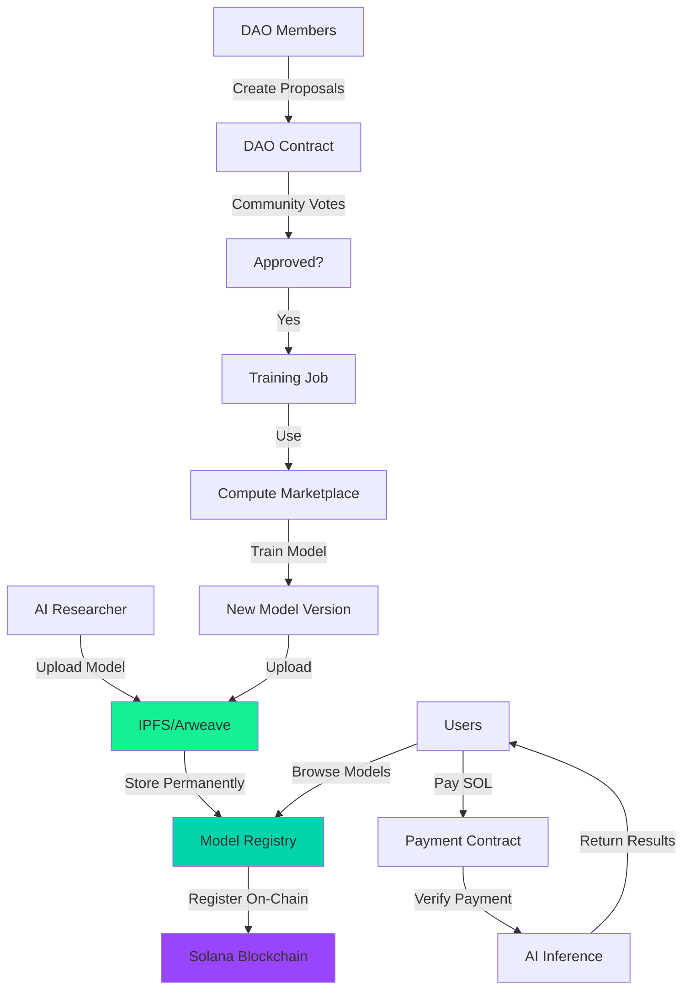

# What is Train2Earn?

## Overview

**Train2Earn** is a groundbreaking decentralized artificial intelligence platform built on Solana blockchain that revolutionizes how AI models are created, stored, governed, and monetized.

## The Problem

Traditional AI development faces several challenges:

- **Centralization**: Big tech controls AI models and infrastructure
- **High Costs**: Training and hosting models is expensive
- **Lack of Transparency**: Model weights and training data are proprietary
- **No Community Input**: Users have no say in AI development direction
- **Storage Issues**: Models can disappear or become inaccessible
- **Monetization Barriers**: Individual researchers struggle to monetize models

## Our Solution

Train2Earn addresses these challenges through:

### 🔓 Decentralization
- Models stored on IPFS and Arweave (permanent, censorship-resistant)
- No single point of failure
- Community-owned infrastructure

### 💰 Tokenized Economy
- Earn SOL for contributing quality models
- Pay-per-use AI inference with transparent pricing
- Validator rewards for model verification

### 🗳️ Democratic Governance
- DAO votes on model improvements
- Token-weighted decision making
- Community-driven development

### ⚡ Cost-Effective Training
- Leverage Akash and Golem compute networks
- 10x cheaper than AWS/GCP
- Decentralized GPU marketplace

### 🔐 Verifiable AI
- Zero-knowledge proofs for model integrity
- Transparent training data provenance
- Immutable on-chain records

## How It Works

