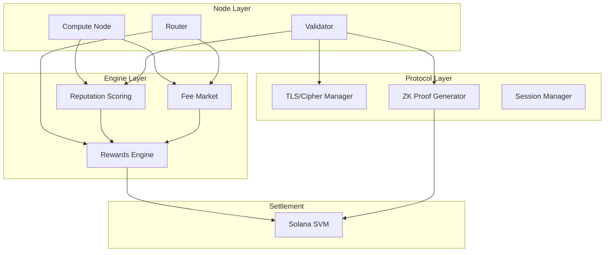

# Clawd Sovereign Compute Node

## Decentralized Compute, Validator, and Router Network on Solana

> **Protocol**: `clawd.sovereign-node.v1`  
> **Status**: Implementation-ready (Release 0)  
> **Dependencies**: Solana SVM, Phantom MCP, Helius RPC, Arweave/IPFS

---

## 1. Overview

The Clawd Sovereign Compute Node allows any participant to spin up a node and earn rewards by contributing bandwidth, computation, and verification to the network. The system is modeled on the Grass decentralized infrastructure architecture and integrated with the Clawd protocol specification.

### Node Types

| Type | Role | Reward Source |
|------|------|---------------|
| **Compute Provider** | Execute compute/AI jobs and relay web traffic | Bandwidth + compute fees |
| **Validator** | Verify web transactions, manage TLS sessions, batch ZK proofs | Validation fees + commission |
| **Router** | Route traffic geographically, manage connected nodes | Router staking rewards |
| **Hybrid** | Full node: validate, route, and compute | All reward streams |

### Platform Uptime Boosts

| Platform | Bonus |
|----------|-------|
| Android | **3x** (highest) |
| Mac | **2x** |
| Windows | **2x** |
| Linux | **2x** |

---

## 2. Architecture



### Core Components

1. **nodeReputation.js** — Grass-style reputation scoring (R = wC·C + wN·N + wT·T + wA·A)
2. **feeMarket.js** — Dynamic gas fee calculation (G = (kg·g + kr·r + kt·t + kb·b)(1 + kc·c))
3. **nodeRewards.js** — Router/delegate reward distribution (Rd = Rp + Sd·((D·I)/T))
4. **validatorCore.js** — TLS session management, cipher negotiation, ZK proof generation
5. **nodeRouter.js** — Geographic routing, health reporting, slashing risk assessment
6. **sovereignNode.js** — Main orchestrator class integrating all components

---

## 3. Reputation Scoring

### Formula

```
R = wC · C + wN · N + wT · T + wA · A
```

Where:
- **C** = Completeness — Is the data complete or are elements missing?
- **N** = Consistency — Uniformity across data sets or over time
- **T** = Timeliness — Is the data up-to-date when needed?
- **A** = Availability — Can the data be reliably accessed?

### Dynamic Weight Allocation

- **wC = 0.5** (fixed — Completeness is highest priority)
- Remaining 0.5 distributed dynamically:
  - wN ∝ σ(N) = standard deviation of consistency across active nodes
  - wT ∝ σ(T) = standard deviation of timeliness across active nodes
  - wA ∝ σ(A) = standard deviation of availability across active nodes

### Reward Tiers

| Tier | Score Range | Multiplier |
|------|------------|------------|
| NONE | 0.0 - 0.2 | 0x |
| BRONZE | 0.2 - 0.4 | 0.5x |
| SILVER | 0.4 - 0.6 | 1.0x |
| GOLD | 0.6 - 0.8 | 1.5x |
| PLATINUM | 0.8 - 0.9 | 2.0x |
| DIAMOND | 0.9 - 1.0 | 3.0x |

---

## 4. Fee Market

### Gas Fee Formula

```
G = (kg · g + kr · r + kt · t + kb · b) · (1 + kc · c)
```

**Parameters:**
- `g` = Geography of the target node (demand-adjusted)
- `r` = Reputation of the target node
- `t` = Traffic type (PET = 0.8, FET = 1.5)
- `b` = Bandwidth consumed
- `c` = Network congestion factor (0-1)

**Dynamic Coefficients:**
- `kg` = 0.15 (Geography weight)
- `kr` = 0.25 (Reputation weight — decreases with more nodes)
- `kt` = 0.20 (Traffic type weight)
- `kb` = 0.40 (Bandwidth weight)
- `kc` = 0.10 (Congestion — increases with utilization)

### Traffic Types

- **PET (Partially-Encrypted Traffic)**: Dual-phase encryption (client→validator→target). Lower cost (0.8x). Validator can assess quality.
- **FET (Fully-Encrypted Traffic)**: End-to-end encrypted. Higher cost (1.5x). No validator visibility.

---

## 5. Rewards

### Node Operator Rewards

```
baseReward = bandwidthTier.baseRewardLamports
repMultiplier = getRewardTier(reputationScore).multiplier
uptimeBoost = UPTIME_BOOSTS[platform]
uptimeRatio = min(1, uptimeHours / (24 * 30))

totalReward = baseReward × repMultiplier × uptimeBoost × (0.5 + 0.5 × uptimeRatio) + trafficReward
```

### Router Delegate Rewards

```
Rd = Rp + Sd · ((D · I) / T)

Split:
Rc = Rd · (1 - C)  (delegate claim)
Ro = Rd · C         (router operator claim)
C = commission rate (1-50%)
```

---

## 6. Validator TLS & Encryption

### Supported Cipher Suites

| Cipher | Key Length | IV Length | Auth Tag |
|--------|-----------|-----------|----------|
| AEAD (AES-256-GCM) | 32 bytes | 12 bytes | 16 bytes |
| ChaCha20-Poly1305 | 32 bytes | 12 bytes | 16 bytes |
| AES-256-CBC | 32 bytes | 16 bytes | 0 |
| AES-128-GCM | 16 bytes | 12 bytes | 16 bytes |

### Session Management

1. ClientHello → ServerHello (cipher negotiation)
2. Pre-master secret generation (per-session random)
3. Master secret derivation (PRF: SHA-256)
4. Session key generation (client/server write keys + IVs)
5. Encrypted session established (1 hour TTL)

### ZK Proof Pipeline

1. Validator completes TLS handshake with target
2. Traffic is decrypted, validated for quality metrics
3. Validation result + session data → ZK proof input
4. Proof hash committed to chain
5. Batched settlement on Solana via clawd-core program

---

## 7. API Endpoints

### Node Operations
```text
POST   /api/sovereign-node/register          Register a compute node
POST   /api/sovereign-node/heartbeat         Node liveness heartbeat
POST   /api/sovereign-node/session           Record processed session
POST   /api/sovereign-node/reputation        Update reputation scoring
GET    /api/sovereign-node/rewards/:nodeId    Get accumulated rewards
GET    /api/sovereign-node/status/:nodeId     Get node status
GET    /api/sovereign-node/leaderboard        Node leaderboard
GET    /api/sovereign-node/network-stats      Overall network statistics
POST   /api/sovereign-node/analyze-traffic    Traffic gas fee estimate
```

---

## 8. Quick Start

### Prerequisites
- Node.js 18+
- Solana wallet (Phantom recommended)
- 0.01+ SOL for gas

### Installation

```bash
# Install dependencies
npm install

# Copy environment config
cp .env.example .env
# Add your HELIUS_API_KEY, OPENROUTER_API_KEY etc.

# Start the development server
npm run dev
```

### Starting a Node

1. Connect your Solana wallet
2. Navigate to the **Sovereign Compute Node** tab in the dashboard
3. Configure node type, region, and max sessions
4. Click **Launch Sovereign Node**
5. Toggle **Simulate Traffic** to begin processing sessions

### Running as a Server-only Node

```bash
node scripts/start-node.js --type validator --region us-east --wallet YOUR_WALLET_ADDRESS
```

---

## 9. Verification and Settlement

Every session processed by a sovereign compute node goes through:

1. **Traffic Validation** — Validator measures completeness, consistency, timeliness, availability
2. **ZK Proof Generation** — Session data is hashed into a verifiable proof
3. **Reputation Update** — Moving average of node reputation score
4. **Reward Accumulation** — Lamports earned per session based on bandwidth, quality, and uptime
5. **On-chain Settlement** — Batched proofs submitted to clawd-core program on Solana

---

## 10. Security Model

- **No private keys in containers**: Wallet signer is isolated from workload runtime
- **Per-session encryption keys**: Ephemeral TLS sessions with 1-hour TTL
- **Content-addressed digests**: All artifacts verified by SHA-256 before use
- **Slashing protection**: 75% connectivity threshold with 5-minute grace period
- **Sybil resistance**: Reputation-based node selection, not capital-based

---

## 11. Files Reference

| File | Purpose |
|------|---------|
| `src/utils/nodeReputation.js` | Grass-style reputation scoring engine |
| `src/utils/feeMarket.js` | Dynamic gas fee market engine |
| `src/utils/nodeRewards.js` | Rewards distribution engine |
| `src/utils/validatorCore.js` | TLS/cipher/ZK proof validator |
| `src/utils/nodeRouter.js` | Geographic router logic |
| `src/utils/sovereignNode.js` | Main node orchestrator class |
| `src/components/SovereignNodePanel.jsx` | React UI component |
| `server/sovereignNodeApi.js` | Express API endpoints |

---

## 12. Release Plan

### Release 0 (Current)
- Local/devnet vertical slice
- Fixed-price jobs, SOL escrow
- Provider registration, open bids
- Result commitment and reveal
- Three-auditor commit and reveal
- Challenge window
- Node leaderboard and rewards

### Release 1 (AI Workloads)
- Model and dataset registry
- Adapter training template
- Checkpoint commitments
- Hidden evaluation packages
- GPU capability verification

### Release 2 (Federated)
- Federated campaign records
- Robust aggregation policies
- Encrypted artifact exchange
- Secure aggregation adapter